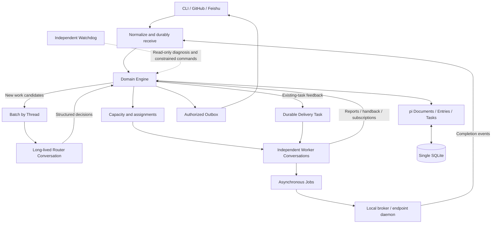
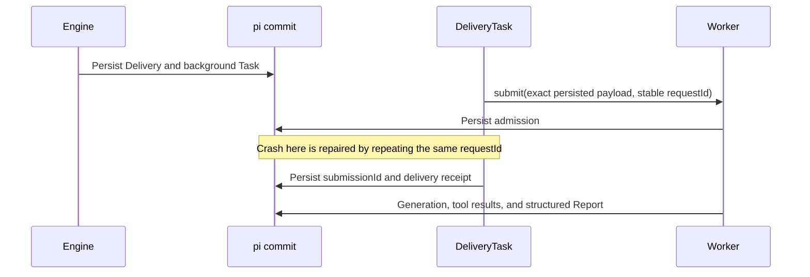
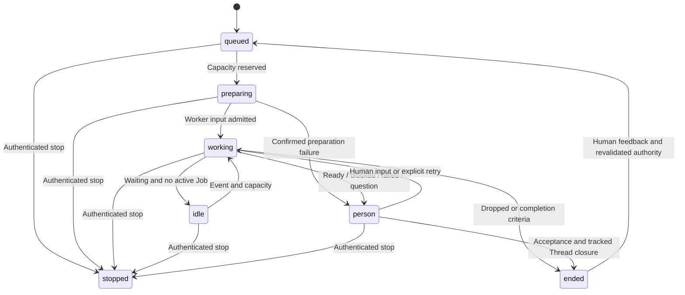

# Super Durable Agent Architecture

Date: 2026-11-02. Design baseline for the implementation stack. Check [checkpoints](checkpoints.md) for implemented versus planned capabilities; passing contract probes alone does not establish a complete runtime.

This design maps the DeepSeek Super-agent organization onto pi durable Conversations, Documents, Tasks, and Submissions. Users manage goals, authority, progress, and acceptance while the system manages internal conversations. [Evidence and version boundaries](research/evidence.md) distinguish the original design, the published prototype, and this project's verification.

## Goals and scope

Preserve four goals: **Continuous** context across events; **Productive** independent work in parallel; **Proactive** work discovered under configured rules; **Persistent** progress across process interruptions.

The first deployment serves one project and trust boundary with one active control process, one Harness Session, and one SQLite database. Start with a CLI/local source, then integrate GitHub, Feishu, remote endpoints, and external supervision. Models are configured through pi-ai; the architecture does not require a DeepSeek model.

Pin pi-durable, pi-ai, and chord to **1.1.0**. The API is experimental, and upstream main contains features absent from this release. Upgrade only after public-API contract, schema, checkpoint-migration, and recovery checks. Defaults below are project decisions, not measurements or guarantees from the original research.

## Topology

The Harness commit is the only atomic write boundary for domain state and execution intent. Engine commands read documents, validate invariants, update documents and indexes, append audit entries, and create durable Tasks in one commit. Model, network, filesystem, and shell operations run **outside** commits. Do not introduce a second ORM writing pi's internal tables.

Preserve the original prototype's domain responsibilities while using pi Tasks for durable effects rather than maintaining a separate competing recovery engine.

## Architectural decisions

| Decision | Choice and consequence |
| --- | --- |
| Persistence | One trust boundary per Harness Session; documents, entries, and task intents commit together |
| Domain state | Session-scoped document families keyed by object ID; bounded indexes, not one growing JSON object |
| Work identity | Ticket is long-lived work; Assignment is an execution arrangement; pi Task is a recoverable state machine |
| Router | Independent long-lived Conversation with routing/recall tools only; dispatch returns immediately |
| Worker | One ownerless Conversation per Ticket; explicit role extensions/tools; no Router-history fork by default |
| Background work | Conversation-owned background Tasks on Control, outside Router generation/tool ownership |
| Cancellation | Persist revocation and epoch fencing first; then run idempotent cancellation intents |
| Delivery | Durable intent plus payload-bound requestId; submit and delivery receipt are separate commits |
| External effects | Job/Outbox ledger, stable operation identity, remote receipts, and explicit unknown outcomes |
| Deployment | Application singleton lock; never let two Harness writers share the database |

Task-owned child conversations inherit their owner's cancellation and failure. That is useful for a tool-local subtask, but unsuitable for a persistent Worker that must survive Router completion or cancellation. Store the Ticket/Assignment/Conversation relationship in documents instead. Control's finite Drive, Delivery, Relay, Job, and Outbox Tasks coordinate ownerless Workers; Engine explicitly cancels both control tasks and Worker work. An idle Ticket needs no permanently running anchor Task.

A background anchor owning a child is an alternative whose cancellation boundary is characterized by a probe. It is not the selected production ownership model.

## Records and indexes

IDs include the instance scope. Store UTC milliseconds, distinguish occurrence and receipt times, and assign a durable receive ordinal. Mutable aggregates carry a revision; commands with stale expected revisions fail before changing state.

| Record | Essential fields | Storage |
| --- | --- | --- |
| Source | id, kind, enabled, listenedScopes, cursor | Session family `sa.source` |
| Trigger | id, sourceId, externalId, revision, actor, threads, bodyRef, timestamps, ordinal | Session family `sa.trigger` |
| Disposition | triggerId, ownerTickets, contextTickets, handbacks, acknowledgements, decisionId | Session family `sa.disposition` |
| Thread | key, sourceId, externalRef, lastOrdinal, subscriptions, pendingEval | Session family `sa.thread` |
| Policy | version, acceptMode, admission, allowedActors, rules | Current singleton and immutable version snapshots |
| Eval | id, threadKey, triggerIds, policyVersion, epoch, status, deadlineAt | Session family `sa.eval` |
| Decision | id, evalId, kind, reason, matchedRuleIds, policyVersion | Application-immutable family `sa.decision` |
| Mandate | id, basis, scope, capabilities, constraints, policyVersion, withdrawnAt | Session family `sa.mandate` |
| Ticket | id, goal, mandateId, workerConversationId, assignmentId, lifecycle, latestReport, attention, revision | Session family `sa.ticket` |
| Assignment | id, ticketId, epoch, environmentId, driveTaskId, submissions, capacityClass, status | Session family `sa.assignment` |
| Delivery | id, ticketId, assignmentEpoch, inputIds, payloadDigest, requestId, submissionId, status | Session family `sa.delivery` |
| Report | id, ticketId, assignmentEpoch, kind, summary, artifacts, consumedInputIds, sourceEntryId | Session family `sa.report` |
| Outbox | id, ticketId, mandateId, assignmentEpoch, destination, purpose, payloadDigest, key, attempts, nextAttemptAt, receipt, status | Session family `sa.outbox` |
| Job | id, ticketId, assignmentEpoch, operationId, payloadDigest, endpointId, remoteHandle, status, receipt | Session family `sa.job` |
| Command receipt | commandId, canonicalPayloadDigest, outcome | Session family `sa.command` |
| Work index | bounded queues, active reservations, pending evals, deliveries, jobs, outbox IDs | Session documents maintained with their records |

Use `defineDocFamily` and `tx.doc(token, key, seed)` through an application store facade. Session scope keeps work independent of conversation reset, compaction, or fork. Conversation documents contain role and environment bindings, not a second copy of authoritative Ticket state. Credentials stay in the host credential store; documents retain credential references only.

Do not mutate `pi.agent`, `pi.inbox`, or `pi.live` directly. Use public configure/submit/abort APIs. Atomically configure a newly created conversation with the exported **`configure(tx, conversationId, change)`** function; the handle method `conversation.configure()` creates a separate commit and must not be called inside another commit.

Document schema versions/migrations and Task checkpoint versions/migrations are separate responsibilities. Audit Entries hold immutable facts and references. Large bodies/logs use content-addressed artifacts written before their references commit; unreferenced objects are garbage-collected later. External artifacts are outside SQLite atomicity and must be included in backups.

Indexes are explicit application records; no arbitrary SQL query capability is assumed. Enforce bounded capacity before acknowledgement. A source must retry backpressure failures; never advance its cursor or return webhook success before durable admission. Later search databases are rebuildable projections.

## Identity, commands, and replay

Stable IDs alone do not prevent conflicting replay. Bind commandId, delivery requestId, Job operationId, and Outbox key to a canonical payload digest in durable records. Identical retries return the existing outcome; the same key with different meaningful content fails. Exclude transport-only receipt time from event identity. Edits use a new source revision.

Pi requestId is conversation-scoped and does not compare input payload equality. The application performs that check before calling submit. Recover an unknown submit outcome using the same requestId and exact persisted payload, never a rebuilt prompt that might have changed.

## Intake, subscriptions, and ownership

Adapters authenticate source identities and normalize events. Deduplicate by instance/source/external event/revision; a multi-Thread event reaches each Ticket only once. In one commit persist Trigger and Disposition, update Thread membership/indexes, and create routing/delivery intents. Polling cursor advancement is part of the batch admission transaction. Store oversized bodies before that transaction.

Retain the original prototype's distinctions:

- Human feedback on an own Thread belongs to its Worker owners. While owners remain, Router cannot accept, attach, or ignore it again; authenticated stop remains possible.
- Context-only subscriptions deliver information without authority or ownership. They do not wake an ended Ticket by themselves.
- Bot/CI events may supply Worker context and independently enter proactive evaluation. Subscription fanout does not universally bypass Router.
- Each of multiple owners acknowledges, answers, or hands back its responsibility. Re-evaluate only when the final owner releases it.
- Unsubscribe does not erase ownership already assigned. Ending work releases unread and unacknowledged feedback rather than losing it.
- Human-stopped Tickets never automatically resume. Natural completion can be reopened by own-Thread human feedback after Mandate revalidation; bots/CI cannot reopen ended work.

Deduplicate handback with triggerId/ticketId/routingEpoch. Do not attach a message immediately back to the Worker that handed it back in the same epoch. After three ownership conflicts raise attention rather than loop indefinitely.

## Router and authorization

Maintain at most one Eval per Thread and one active Router run per instance. New events arriving during a batch wait for the next batch. Defaults: **32 candidates**, **12,000 summary tokens**, and **100 ms** coalescing window. Cross-Thread candidates can share a model request, but decisions commit independently so a rejected item does not roll back valid siblings. Budget overflow retains references for recall rather than silently dropping candidates.

Router exposes only `list_candidates`, `recall`, `decide_batch`, `note_worker`, and `request_status`. It has no coding shell, editing, general file-write, or direct channel-send tool. Explicit extension/tool allowlists are mandatory because pi otherwise selects every installed extension by default.

Models propose structured accept/attach/ignore/stop decisions. Engine rechecks current Policy version, Eval epoch, actor authority, scope, and ownership at commit. Text cannot grant itself a Mandate or expand an existing one.

| Mode | Inferred work | Admitted explicit human request |
| --- | --- | --- |
| off | No proactive admission | May execute |
| observe | Evaluate and record wouldAccept; no Worker launch | May execute |
| auto | Accept only after enabled-rule match and checks | May execute |

Policy changes invalidate unfinished Eval epochs and enqueue reevaluation; late results are rejected. Notify affected active Tickets without replacing their Mandate through ordinary context. Revalidate ended work before resumption. Explicit stop immediately withdraws authority. Endpoint access revocation is also immediate.

Capabilities include `repo.read`, `repo.write`, `command.execute`, `pr.create`, `pr.merge`, and `channel.reply`. A gateway validates repository, endpoint, operation, budget, epoch, and capability. Natural-language scope remains a model-assisted judgment, not a formal authorization proof. These fine-grained checks describe structured gateways. An explicitly enabled trusted local shell can use the OS account’s network and credentials; command.execute in that mode is a broad grant and cannot enforce a separate no-merge guarantee. Enforce such boundaries with an isolated execution identity/sandbox or leave broad shell disabled.

## Atomic acceptance and delivery

One acceptance commit creates Decision, Mandate, Ticket, own subscriptions, Assignment, queue indexes, and optional acknowledgement intent. Preparation runs afterward in a Drive Task. Commit callbacks perform no external IO and never nest `Conversation.submit()`.

Worker creation, transactional configure, and Ticket binding happen in one commit and are idempotent. Workers are ownerless; Control owns the background coordination tasks. Drive checkpoints are **reserve → prepare → ensureWorker → enqueueDelivery → done**. Completing Drive does not release capacity while generation or Jobs still run. Prepare uses an operation receipt; unknown filesystem results are inspected rather than overwritten.

Track **admitted**, **placed**, **application-consumed**, and **settled** separately. Pi exposes submission placement and done/unanswered outcomes; consumed is application evidence recorded from explicit input IDs in a Report or acknowledgement, not a native pi state or proof of model understanding. A failed run can leave inbox items queued; reconciler must explicitly redrive within budget or raise attention.

Default feedback uses `followUp`; corrections intended for current work use `steer`. Steer joins after the current tool round and does not interrupt an in-flight token computation. Stop/revoke use Engine control commands, not a text input waiting indefinitely behind tools.

## Capacity and lifecycle

Default capacity is **three ordinary reservations plus one human-follow-up reservation**. Preparation, active generation, and active Jobs count. An existing active Worker's steer consumes no extra reservation; an idle Worker must reserve before submit can start generation. Human wakeups precede new launches, with FIFO aging for ordinary work. Pi Task concurrency is separate from this domain limit.

Persist reservation/assignmentEpoch and reconstruct it from live generations, Jobs, and Assignments before dispatch after restart. Unknown endpoint cancellation keeps its capacity reserved or quarantined until confirmation; reboot does not imply empty capacity.

Ticket lifecycle is open/ended/stopped. Derive queued/preparing/working/idle/person stages from Assignment, Report, Attention, and pending inputs rather than independently mutating contradictory status fields.

Worker `report` accepts progress/waiting/ready/blocked/failed/dropped and questions. Validate Worker binding, Ticket, assignmentEpoch, reportId, and consumed input IDs. Plain final prose is not ready; without a structured Report, conservatively record waiting or attention. Ready means reviewable, not accepted. An open tracked PR keeps the Ticket open. Closure/merge ends work only if no pending followup, newer execution, active/unknown Job, or unsettled current final-message obligation remains. Untracked one-shot work can end under an explicit acceptance policy.

Reports/questions/artifacts go through purpose-aware Outbox. Keep tool logs internal; IM replies are concise, GitHub descriptions include the problem/change/validation. Silence rules suppress unnecessary acknowledgements and progress. Routine progress need not wake Router.

## Asynchronous Jobs and execution boundary

A durable tool Task does not make its generation loop nonblocking: the loop still waits for the current tool round. Provide `start_job`, `get_job`, and `stop_job`. start_job commits Job plus execution intent and stable payload-bound operationId, then returns immediately. Execute outside the transaction; completion becomes a deduplicated `job:<id>:completed:<receiptVersion>` event delivered to the Worker.

Stop Job cancels that operation; stop Ticket withdraws its Mandate and cancels all owned operations. `replay: safe` is allowed only for receipt-backed or genuinely read-only operations. Arbitrary shell, messages, and PR merges are not made exactly-once by an annotation. Interrupted unknown shell work requires receipt/environment inspection before retry.

Local broker preparation creates Ticket-specific worktrees. **A worktree is not a sandbox.** The first local command executor is an explicitly enabled trusted-local-shell mode: authorizing it grants the OS account's command/file/network reach. Repository path guards on structured read/write operations do not confine shell subprocesses. Do not advertise branch/filesystem/network confinement for that mode. Untrusted execution requires a separately configured OS/container sandbox and credentials boundary; fail closed if such confinement is requested but unavailable. Test path/symlink escapes for structured operations and test that untrusted shell is refused by default.

EnvironmentBroker exposes prepare/execute/query/cancel/release. Mutating requests carry operationId, payload digest, assignmentEpoch, and explicit authorization. Credentials are resolved by the broker without entering model context. The remote daemon retains a minimal durable operation ledger and receipts, not conversation history, so reconnect can query rather than repeat unknown commands.

## Cancellation and Outbox fencing

stopTicket atomically withdraws Mandate, marks stopped, increments assignmentEpoch, invalidates pending Delivery/Report progression, cancels unsent Ticket Outbox entries, and records Cancel intents. Cancellation then stops Control tasks, Worker ordinary/background work, and endpoint Jobs. Old epochs cannot revive work, produce feedback, or authorize outbound messages.

**Reconciliation is not progress.** Late completion/cancel receipts from old epochs may update execution ledgers and release confirmed capacity, while leaving the Ticket stopped and producing no new domain progress or reply. In-flight external commands may already have effects; stop cannot retroactively undo them. Keep stopping/cancelPending visible until receipt or attention.

Outbox persists payload, digest, destination, purpose, Ticket/Mandate/epoch, idempotency key, and receipt. Recheck fresh authorization immediately before sending, including previously queued messages after restart. Source disabled defers; destination no longer listened to drops with a reason. System administrative messages require a separate authenticated authority basis, never an implicit bypass.

Sending races with revocation after the last local check. Already-in-flight sends are not guaranteed retractable; track their receipt or uncertain state rather than claim stop prevented them. Use provider idempotency keys where supported. If send succeeded before local receipt committed, query remote markers/receipts. **Found** repairs the receipt; **confirmed absent** may retry the same operation; **unknown** becomes uncertain and is not blindly resent.

Ordinary retryable failures back off from **2 seconds** to **60 seconds**, with jitter; **eight failures** raise attention. Persist attempt/nextAttemptAt. Never retry an unknown non-idempotent outcome as an ordinary known failure.

## Context and continuity

Router sees candidate summaries, Ticket/authority summaries, and essential cross-task links. Worker sees its Mandate, goal, bound Thread feedback, and required artifacts. Do not copy global Router history by default. Optional Worker-local subagents remain under the same authority ceiling and explicit tool selection.

Inline current summaries and pointers; spill large bodies/logs into durable artifacts. `recall(ref, cursor, limit)` traverses Trigger → Thread → Ticket → Assignment → Report, paginated and role-checked, with a default **8,000-token** result budget. Citation/reference graphs survive model forgetting.

Pi compaction reduces model context while retaining old Entries. It is neither authorization nor a domain database. Rehydrate scope/Mandate/current IDs from committed documents in prompt sections. Avoid volatile unrelated system-section content that defeats prompt caching. Reset never deletes domain work; fork never implicitly grants another Ticket's authority.

## Recovery and deployment

Startup: acquire singleton lock → open storage → install compatible Registry/migrations → obtain Control/Router → preflight stored document/task versions and required definitions → reconstruct reservations and pending control intents → resume scheduler → start sources/timers. Do not call submit/wait/abort before preflight because those APIs can start scheduling. Unknown/missing definitions or failed migration block affected effects and expose diagnostics rather than deleting work.

Pi restores checkpoints/inbox/generation/tool state. Reconciler repairs domain/external mismatches. Interrupted provider requests may be retried and billed again; durability does not resume provider computation from the same token.

| Failure window | Required behavior |
| --- | --- |
| Before intake acknowledgement | Source retries; stable event key deduplicates |
| Commit rollback | Domain documents, indexes, and Task intents all roll back |
| Submit admitted, receipt missing | Same persisted payload/requestId reacquires Submission |
| Preparation succeeded, receipt missing | Query operation marker; do not overwrite unknown checkout |
| Failed run leaves queued feedback | Explicit bounded redrive or attention |
| Stale report/completion | Reject progress; allow receipt-only reconciliation |
| Queued stale Outbox after stop | Fresh authorization rejects before send |
| Send result unknown | Query receipt; unresolved becomes uncertain |
| Missing definition/migration failure | Fail closed with diagnostics and recovery instructions |
| Endpoint disconnected/cancel pending | Query on reconnect; do not repeat unknown operation |

Pi Task `waiting.on` refers to Task IDs, not arbitrary domain events. External waiting is represented in documents and awakened by new intake/dispatch. Continuing Task delays persist their deadline in checkpoints and use runtime.sleep. Deferred Outbox intents instead persist nextAttemptAt transactionally and use finite sender Tasks when due; startup and explicit reconciliation recover due work. An unreferenced host timer may wake that reconciler, but never owns retry state. Memory-only timers are insufficient after restart.

SQLite WAL/NORMAL supports process-crash recovery but does not promise zero loss on power/host failure. Backup/restore must capture a consistent database plus artifacts and compatible definitions; restore into a new directory and verify before replacing service state. Endpoint operation admissions and receipts are independent safety-critical state: preserve/validate local broker ledgers and repository dependencies, or require reconciliation with the original endpoint before resuming active Jobs. An empty replacement broker is not evidence that an old command was never launched. A corrupt/unsupported store is not silently initialized as empty.

Future cloud deployment still needs one active writer per Session. Pi 1.1.0 provides no cross-process ownership lease or distributed SQLite writer election; external leases/fencing/storage failover are prerequisites, not implied capabilities.

## Independent supervision

Watchdog runs in another process with separate storage and budget. It reads health, taskGraph, progress, endpoint status, and cost through authenticated management APIs; it never opens the primary database. Infrastructure probes inspect source cursor age, delivery backlog, durable progress, and endpoints. Semantic evaluation runs only on candidates such as repeated commands/no new artifacts or budget anomalies.

Defaults: **60-second** infrastructure probes and a **15-minute** no-progress threshold. Waiting for people/endpoints or a legitimately active long Job is not automatically a stall. Automated actions are limited to requestStatus, known-safe retry, pause, and notify; policy changes, reauthorization, and destructive repair need separate authority. Unchanged/nonactionable state stays quiet. Persist notification deduplication and model budget across restarts.

## Interfaces and implementation ownership

Domain facade: receive/receiveBatch, decide, handback, report, stopTicket, retryTicket, updatePolicy, bind/subscribe/unsubscribe, and read/list. Caller roles expose only their allowed subset. A Worker cannot accept work or stop an unrelated Ticket. Management writes enter the same Engine; identities come from authentication, not request bodies.

Modules: `src/domain/` owns records/rules/transactions; `src/durable/` owns Documents and Tasks; `src/agents/` owns role extensions and context; `src/runtime/` owns locking/scheduling/reconciliation; `src/environments/` owns execution; `src/sources/` owns adapters; `src/api/` and CLI provide interaction; `src/daemon/` and `src/watchdog/` provide separate processes. Exact exported interfaces are introduced with their implementation PR and tested at the next consuming boundary.

The [implementation plan](superpowers/plans/2026-11-02-super-durable-agent.md) splits this into ten independently reviewable PRs. Each has an issue, incremental base branch, executable checkpoint, regression tests for its failure windows, and an implementation-status entry. No stacked PR is automatically merged.

End-to-end acceptance follows an export failure: Router accepts → Worker A investigates → same-Thread filename feedback goes directly to A → another request creates B → human feedback works at normal capacity → a long test runs as a Job → process dies and recovers → ready waits for PR review → merge ends the Ticket only after remaining feedback settles. Measure routing decisions, feedback placement latency, backlog, completion latency, intervention, costs, and uncertain effects. Original simulated benchmark numbers are not this project's acceptance targets.
