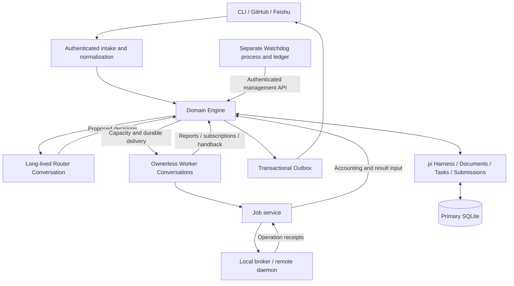

# pi-durable Super Agent: Technical Reference

Runtime baseline: pi-durable, pi-ai, and chord 1.1.0.

This reference explains how the system works and where its guarantees end. It uses the Router/Worker model from the DeepSeek Super-agent design, implemented with pi persistence and execution. The CLI supports OpenAI and Anthropic models; a DeepSeek model is not required.

For configuration and commands, use [Operations and recovery](operations.md). For exact host interfaces, use [Runtime API](api.md). The [architecture baseline](architecture.md), [source evidence](research/evidence.md), and [implementation checkpoints](checkpoints.md) record the design and validation history.

## 1. System model

A Super Agent keeps work and context across messages and restarts. A long-lived Router evaluates new work. A separate Worker handles each accepted Ticket, retaining context as feedback, tool results, and external events arrive. The Engine owns authorization and state transitions. Models propose actions through constrained tools.

The design supports four properties:

- **Continuity:** related events return to the responsible Worker and retained coding workspace.
- **Concurrency:** independent Workers and asynchronous Jobs can progress together within explicit capacity limits.
- **Proactivity:** enabled Policy rules can authorize inferred work; source content alone cannot grant permission.
- **Persistence:** committed state and execution intent survive process interruption, and records external operations whose outcome is unknown.

### Components and trust boundaries



One primary process controls one Harness Session and SQLite database. An OS-held advisory lock prevents a second cooperating primary writer. Execution endpoints and the Watchdog keep separate ledgers so their records survive a primary-process crash.

## 2. Mapping to pi

| Application concept | pi mechanism | Application responsibility |
| --- | --- | --- |
| Authoritative domain state | Session-scoped Document families | Validate records, revisions, ownership, indexes, and authorization |
| Atomic state transition | Harness transaction/commit | Persist domain changes and native execution intent together |
| Router and Workers | Conversations with explicit extension/tool allowlists | Bind roles, Ticket identity, context, and capability ceilings |
| Internal coordination | Finite background Tasks owned by Control | Persist claims, recover attempts, enforce capacity, and schedule effects |
| Worker input | Submissions with conversation-scoped requestId | Freeze exact payload and reject conflicting key reuse |
| Audit history | Entries and application receipts | Record decisions, consumption, authority, and observed outcomes |
| Model integration | pi-ai Models and configured provider/model | Resolve credentials outside prompts and select supported models |
| Recovery | Native Task checkpoints and persisted inbox/generation state | Reconcile domain intent with native and external receipts |

A Harness commit saves domain state and native execution intent atomically. Network requests, model calls, Git/filesystem operations, and subprocess execution happen outside it. External work is represented by durable intent and receipts; it is not made atomic with SQLite.

Workers are Conversations without a parent Task. A task-owned child Conversation would inherit its owner's cancellation/failure, which is unsuitable for work that must survive Router completion or abort. Control owns background coordination Tasks, and Engine commands explicitly cancel the relevant Worker and work when required. An idle Ticket needs no running Task.

## 3. Identity and state

| Entity | Meaning and lifetime |
| --- | --- |
| Source / Thread | Authenticated event source and the external conversation or issue/PR scope |
| Trigger / Disposition | Immutable normalized input and its responsibility/context/acknowledgment bookkeeping |
| Eval / Decision | A frozen routing evaluation and its validated outcome under a Policy version |
| Mandate | Persisted authorization basis, scope, capability ceiling, and revocation state |
| Ticket | Long-lived user goal, Worker binding, lifecycle, latest result, and attention |
| Assignment | Execution arrangement for a Ticket, including a fresh epoch and capacity state |
| Delivery / AgentRun | Durable input obligation and the exact frozen prompt/native execution binding |
| Report | Structured Worker result with explicit consumed input IDs |
| Job | Asynchronous operation with stable external identity and accounting state |
| Outbox message | Authorized external communication intent, retry state, and receipt |

Ticket, Assignment, Conversation, and native Task IDs are distinct. Retrying a Ticket creates a new Assignment/epoch while preserving the Ticket and Worker context. Resuming work does not require reusing a native Task ID.

Each command, submission, Job, and Outbox key is bound to a hash of its normalized payload. An identical replay returns or reconciles the existing outcome; the same key with different meaningful content is rejected. pi's requestId deduplication alone does not compare payload equality, so the application performs that check.

Mutable domain records carry revisions. Bodies and frozen prompts larger than 16 KiB of UTF-8 are stored as artifacts identified by SHA-256 hashes. Recall checks authorization and returns paginated content; a hash alone does not grant access.

## 4. Workflows

### 4.1 Intake, routing, and acceptance

1. A source adapter authenticates the sender, verifies the transport envelope, and normalizes an event. Message text cannot supply an operator identity.
2. The Engine deduplicates the event and commits its Trigger, Disposition, Thread relationships, and routing/delivery intent. Poll cursor and webhook replay bookkeeping advance only with durable admission.
3. Existing responsibility determines direct Worker delivery where appropriate. New or proactive candidates enter a frozen Eval, serialized for overlapping Thread work.
4. The Router proposes structured decisions using restricted routing/recall tools. It has no coding shell or direct channel-send tool.
5. The Engine rechecks Policy version, Eval identity, actor, scope, ownership, and capabilities before accepting a decision.
6. Acceptance atomically creates the Ticket, Mandate, Assignment, subscriptions, and execution intent. Capacity admission and Worker creation follow through durable coordination.

| Policy mode | Inferred work | Authorized explicit human request |
| --- | --- | --- |
| off | No proactive admission | Can be accepted after checks |
| observe | Record evaluation without launching inferred work | Can be accepted after checks |
| auto | Accept only under enabled matching rules and checks | Can be accepted after checks |

Explicit requests default to `repo.read` and `channel.reply`. Writing, shell execution, or other powers require trusted configuration and applicable Policy grants.

### 4.2 Worker delivery and feedback

```mermaid
sequenceDiagram
  participant S as Source
  participant E as Engine / Control
  participant P as pi commit
  participant W as Worker
  S->>E: Authenticated normalized input
  E->>P: Trigger + ownership + delivery intent
  E->>P: Reserve capacity; bind Worker; freeze payload
  E->>W: Submit exact payload with stable requestId
  W->>P: Native admission and input placement
  E->>P: Record submission receipt
  W->>E: Structured Report with consumed input IDs
  E->>P: Report + consumption + outbound intent
```

Delivery distinguishes **admission**, **placement**, **application consumption**, and **settlement**. A submission receipt is not evidence that the model understood or handled the input. Consumption comes from a validated Report referencing input IDs actually placed for that Worker.

Normal feedback uses followUp. A host-selected correction can use steer, which joins at an appropriate generation/tool boundary rather than interrupting an in-flight token computation. Stop is an Engine command, not an ordinary message queued behind model work.

Human feedback on an owned Thread goes directly to its responsible Worker owners. Context subscriptions convey information without ownership or additional authority. Each owner consumes its own obligation. Handback releases responsibility for reevaluation after the final owner releases it; bounded conflict handling prevents routing loops.

### 4.3 Asynchronous Jobs and late receipts

`start_job` commits the Job and execution Task, then returns a Job ID without waiting for command completion. `get_job` inspects the operation; `stop_job` cancels that operation. Workers can receive further input while a long command runs.

The broker prepares a workspace lazily, obtains fresh authority, persists operation admission, and executes outside the primary transaction. Operation ID, payload digest, Ticket, Assignment, and epoch bind the receipt to its original intent.

If a remote operation outlives a transport deadline, the primary retains running/unknown accounting. Finite query-only native Tasks reconcile the original operation:

- Each Task performs at most one receipt lookup and cannot prepare, execute, or cancel work.
- Persisted retry delays increase from 2 seconds to a 60-second cap.
- At most one receipt lookup per Job and eight per runtime can be active at once.
- Startup resumes unfinished claims and schedules due checks; in-memory timers only wake reconciliation.
- Absence, timeout, or lookup failure never authorizes command replay.

A terminal receipt updates accounting and sends the current authorized Worker a distinct, deduplicated result even if an earlier uncertainty notification was consumed. A receipt can clear the uncertainty warning for that Job. Other warnings remain. Receipts for stopped or older Assignments update accounting only.

### 4.4 Reports, external replies, and completion

Reports support progress, waiting, ready, blocked, failed, dropped, and attention, with typed questions and waiting reasons. The Engine validates Worker binding, Assignment/epoch, report identity, and consumed inputs. Questions represent human waiting; ready means reviewable work.

The Report and its outbound intent commit together. The Outbox rechecks current Mandate, Policy, epoch, source, destination, and communication rules before sending. Routine progress is quiet unless configured otherwise.

Sender adapters distinguish a found receipt, authoritative absence, and an unknown outcome. Known no-send failures or authoritative absence permit bounded retries of the same immutable intent; a generic network error does not. Outbox attempts use persisted deadlines, jittered 2-to-60-second backoff, and an eight-attempt bound. Missing adapters leave visible pending intent.

Ticket lifecycle is open, ended, or stopped. Ready alone does not end a Ticket. For tracked GitHub work, authenticated closure facts can complete it only after pending feedback, newer execution, active/unknown Jobs, and current final-message obligations are settled. Eligible human feedback can naturally reopen ended work after revalidation. Stopped work requires explicit authorized retry.

### 4.5 Stop and retry

1. Persist Mandate revocation and epoch fencing first.
2. Invalidate queued input and outbound work for the revoked execution.
3. Cancel native Worker/background work and endpoint operations through durable cancellation intent.
4. Persist confirmations monotonically; retain unknown outcomes and capacity quarantine until resolved.

Per-Job cancellation is operation-specific. Remote cancellation binds the exact original operation and can leave a durable tombstone before delayed execution arrives. Ticket-wide revocation uses a separate trusted epoch-revocation grant; cancelling one Job does not disable unrelated same-epoch operations.

Explicit Ticket retry revalidates authority and creates a fresh Assignment/epoch. The previous cancellation must be confirmed before the Worker can be reused. Cancellation does not undo already completed external effects.

### 4.6 Restart and recovery

Startup acquires the primary lock, validates restore dependencies and supported Document/Task definitions, constructs the runtime paused, and reconciles persisted work before activation. Hosts using `startPaused` configure listeners and trusted bindings before calling `activate`. Model-free reopening preserves agent-work inspection restrictions.

| Interrupted boundary | Recovery behavior |
| --- | --- |
| Before committed intent | No committed work is assumed |
| After native submission but before delivery receipt | Repeat the same persisted payload/requestId and recover admission |
| Terminal auxiliary Task without settled domain intent | Bounded redrive or explicit attention |
| External command admitted without trustworthy completion | Retain unknown; inspect/query the original operation |
| Outbound response lost | Query provider receipts; do not assume the send failed |
| Revoked epoch produces a late result | Update accounting without reauthorizing work or notifying a stale Worker |
| Unknown definition/version or missing endpoint history | Fail closed before enabling effects |

Native Task migrations and Document compatibility are separate gates. Host-installed compatible Task upgrades require explicit migration permission and pure registered migration functions. Migration callbacks can run during validation and again at native reservation; they must not perform external effects. Unsupported Document definitions, versions, scopes, or envelopes are rejected.

## 5. Environments, capacity, and supervision

### Ticket workspace continuity

Physical coding workspaces are retained by Ticket and canonical repository. Each Assignment keeps an immutable lease/environment identity, while the current workspace marker fences old leases. Natural resumption and explicit retry preserve commits, dirty files, and original base metadata under fresh authority.

Active/unknown old operations block lease transfer. Explicit incompatible bases and ambiguous legacy workspaces fail closed. A stale lease cannot execute in or release the current workspace. Structured filesystem tools reject path escapes and repository-metadata access under the documented trusted-filesystem assumptions.

Trusted shell is disabled by default and requires both configuration opt-in and `command.execute`. When enabled, it inherits the OS account's filesystem, network, and credential access. A Git worktree is not an OS sandbox. An unavailable requested sandbox is refused.

### Capacity

The default scheduler provides three ordinary reservations plus one reserved for human feedback waking an existing Worker. Preparation, active generation, and pending/running/unknown Jobs count. Feedback to an already active Worker shares its reservation. When an ordinary slot is available, ordinary work is admitted after three human-priority bypasses. Startup reconstructs capacity from persisted domain and native facts; restarting does not erase unknown work.

### Independent Watchdog

The Watchdog runs in a separate process with its own locked ledger. It reads the authenticated management API and never opens the primary SQLite database. Default observation interval is 60 seconds; the no-progress candidate threshold is 15 minutes.

Waiting for people, endpoint/input waits, ready work awaiting review, offline endpoints, and active/unknown Jobs are distinguished from unexplained lack of progress. Missing metrics remain unknown. An optional diagnostic model has no tools and uses a persistently reserved call/token/cost budget; the default semantic budget is zero.

Actions are limited to status requests, reconciliation of existing safe outbound intent, optionally authorized pause, and notification. The Watchdog cannot change Policy, inject work, retry a Ticket, or mint a Mandate. Notification/action deduplication survives restart. Notifications are written as structured data to local stdout; claimed/unknown action outcomes are not blindly replayed after a crash.

## 6. Features and limits

| Area | Implemented behavior | Boundary |
| --- | --- | --- |
| Organization | Long-lived Router; independent per-Ticket Workers; direct owned feedback | Models propose; Engine authorizes |
| Context | Retained Conversations, frozen authority context, artifact spill and paginated recall | Recall checks role and Ticket scope |
| GitHub | Signed webhooks, comment Outbox, receipt lookup, tracked PR lifecycle | No structured PR-create/merge gateway or autonomous polling collector |
| Feishu | Verified callbacks/challenges, replay handling, configured sender identity, outbound replies | CLI tokens/expiry are supplied externally; no implicit OAuth acquisition |
| Execution | Structured file tools, local worktrees, opt-in shell, async Jobs | Local shell is broad OS-account authority |
| Remote endpoint | Direct HTTPS or daemon-outbound polling; independent receipts and continuity checks | Persist controller/daemon history; do not replace missing history with empty state |
| Management | Authenticated operator, viewer, and constrained Watchdog principals | Request bodies cannot claim their own role |
| Recovery | Native checkpoints, payload-bound replay, cancellation fencing, query-only reconciliation | Arbitrary external effects are not universally exactly-once |
| Operations | Offline backup, new-directory restore, version gates, pure Task upgrades | Supported local restore depends on original endpoint paths and history |
| Supervision | Separate Watchdog, quiet unchanged state, persistent diagnostic budgets | No shipped external notification sink or automatic history compactor |

Actual PR creation can use explicitly authorized trusted execution with configured host tooling. A trusted callback binds the confirmed PR to the Ticket; a model's claim that it created or merged a PR is not a lifecycle fact.

## 7. Persistence and deployment boundaries

| State | Owner | Recovery requirement |
| --- | --- | --- |
| Domain records, Conversations, native Tasks | Primary Harness/SQLite | One active writer; compatible definitions and checkpoints |
| Spilled context and prompts | Artifact store | Retain referenced content and validate hashes |
| Admissions, execution receipts, workspace leases | Local broker / remote controller and daemon | Preserve authoritative independent history and canonical identities |
| Supervision observations, budgets, actions | Watchdog ledger | Retain for deduplication and budget continuity |
| Tokens and provider/source configuration | Host environment and protected configuration | Resolve outside model context; do not embed secrets in source messages |

Offline backup holds the primary writer lock and uses SQLite's backup API. It verifies required artifact references and captures a checksummed manifest with endpoint dependencies. Active/unknown local endpoint admissions block a safe offline snapshot. Released workspace history remains retained; a removed workspace is acceptable only with exact durable release evidence.

Restore creates a new primary directory. Supported local activation verifies the original broker inventory, repository paths, and workspace markers without rewinding those originals. Remote/custom restored clones remain inspection-only; no reconciliation-unlock mechanism is shipped. Original and restored primaries must not run concurrently against one endpoint.

This is a single-host primary design using a local filesystem and POSIX advisory locks. It does not supply distributed writer election, portable active-process snapshots, Windows guarantees, or zero-loss host/power-failure durability. Default domain intake/index bounds are 10,000; endpoint, artifact, native query-Task, and Watchdog histories need operator-managed retention planning.

## 8. Source and validation map

| Responsibility | Implementation | Main regression coverage |
| --- | --- | --- |
| Domain, Policy, ownership, lifecycle | [Engine](../src/domain/engine.ts), [Policy](../src/domain/policy.ts), [lifecycle](../src/domain/lifecycle.ts) | kernel, Policy, ownership, cancellation tests |
| Router/Worker input and context | [Coordinator](../src/agents/coordinator.ts), [context](../src/agents/context.ts), [native input Task](../src/durable/tasks/agent-input.ts) | conversation, artifact, scheduling tests |
| Capacity and startup | [Scheduler](../src/runtime/scheduler.ts), [runtime](../src/runtime/open.ts), [migrations](../src/runtime/migrations.ts) | scheduling and recovery tests |
| Jobs and receipt recovery | [Jobs](../src/services/jobs.ts), [receipt reconciler](../src/services/job-receipts.ts), [native Job Task](../src/durable/tasks/job.ts) | Job and remote tests |
| Local/remote execution | [Local broker](../src/environments/local.ts), [remote broker](../src/environments/remote.ts), [daemon](../src/daemon/server.ts) | Job, remote, remote-service tests |
| Outbound and sources | [Outbox](../src/services/outbox.ts), [GitHub](../src/sources/github.ts), [Feishu](../src/sources/feishu.ts) | Outbox, integration, Feishu tests |
| Management and supervision | [API](../src/api/server.ts), [Watchdog](../src/watchdog/core.ts), [runner](../src/watchdog/runner.ts) | integration and Watchdog tests |
| Backup and restore | [Backup](../src/runtime/backup.ts) | recovery and artifact tests |

The [November 5 validation record](checkpoints.md#final-verification-and-acceptance-reconciliation-november-5-2026) reports 295 passing tests across 16 files, seven native pi contract probes, typecheck/build, and CI on Node 22.19 and 24. These are recorded results, not checks rerun for this document. Controlled acceptance covers real SQLite, Git worktrees, subprocesses, authenticated loopback services, signed source fixtures, and native Router/two-Worker execution through a faux provider.

The combined workflow exercises follow-up input, long and queued Job cancellation, restart, Reports/Outbox, PR closure, and coding continuity across resumption/retry. Additional tests cover automatic late receipts on both remote transports and missing frozen-prompt backup rejection. These tests establish controlled execution behavior, not real-provider reasoning quality, live account/device/TLS behavior, or production throughput. Use the [checkpoints](checkpoints.md) for the recorded evidence and the [operations guide](operations.md) to prepare live validation.
